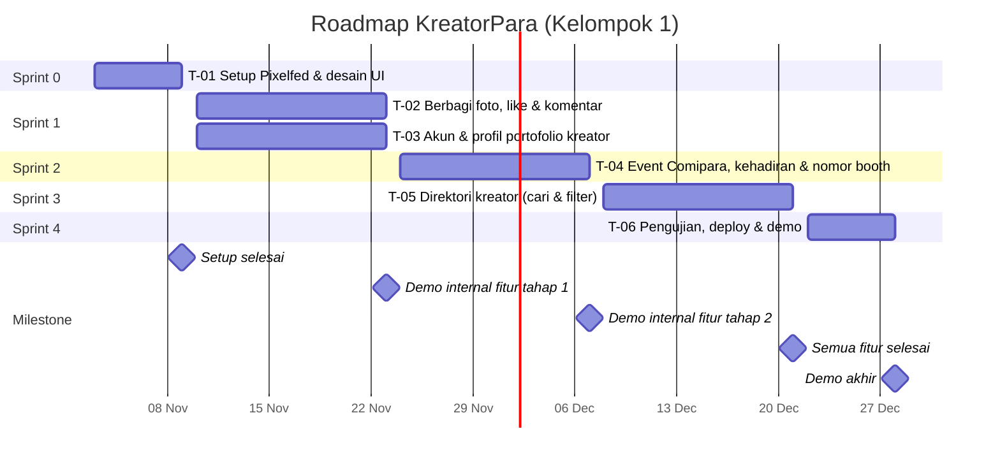

# Roadmap — KreatorPara (Kelompok 1)

Rencana 8 minggu, 3 November – 28 Desember 2026. Repository: <https://github.com/vinix7-development/oktober2-kelompok-1-portofolio-kreator-comipara>

## 1. Linimasa

## 2. Fase & Milestone

| Fase | Tanggal | Fitur / Tugas | Milestone (hasil yang bisa didemokan) |
|---|---|---|---|
| Sprint 0 — Setup & desain | 3 – 9 Nov 2026 | T-01 Setup Pixelfed & desain UI | Aplikasi dasar jalan di laptop semua anggota + wireframe disetujui |
| Sprint 1 — Fitur inti tahap 1 | 10 – 23 Nov 2026 | F-01 Berbagi foto, like & komentar; F-02 Akun & profil portofolio kreator | Demo internal fitur tahap 1 |
| Sprint 2 — Fitur inti tahap 2 | 24 Nov – 7 Des 2026 | F-03 Event Comipara, kehadiran & nomor booth | Demo internal fitur tahap 2 |
| Sprint 3 — Fitur inti tahap 3 | 8 – 21 Des 2026 | F-04 Direktori kreator (cari & filter) | Semua fitur utama selesai |
| Sprint 4 — Pengujian, deploy & demo | 22 – 28 Des 2026 | T-06 Pengujian, deploy & demo | Aplikasi online + demo akhir |

## 3. Status Fitur

Perbarui kolom status setiap akhir sprint: ⏳ Belum · 🔨 Dikerjakan · ✅ Selesai.

| Fitur | Sprint | Status |
|---|---|---|
| F-01 Berbagi foto, like & komentar | 1 | ⏳ Belum |
| F-02 Akun & profil portofolio kreator | 1 | ⏳ Belum |
| F-03 Event Comipara, kehadiran & nomor booth | 2 | ⏳ Belum |
| F-04 Direktori kreator (cari & filter) | 3 | ⏳ Belum |

## 4. Setelah Proyek (pengembangan lanjutan)

Fitur berikut **tidak** dikerjakan di proyek ini, tapi boleh dijadikan bahan pengayaan jika waktu tersisa: forum thread gaya Kaskus, kredit cosplay (tag fotografer/cosplayer), verifikasi centang kreator, laporan pencurian karya, watermark otomatis, QR code profil, federasi ActivityPub, dan pembayaran komisi.
